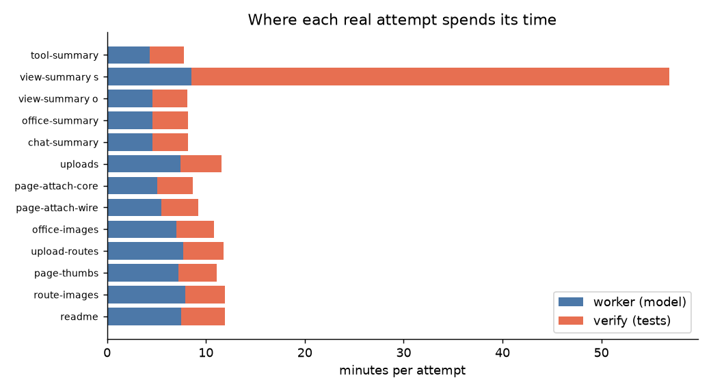
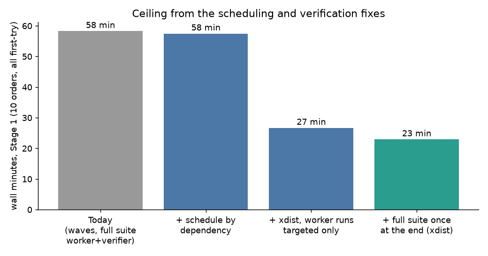
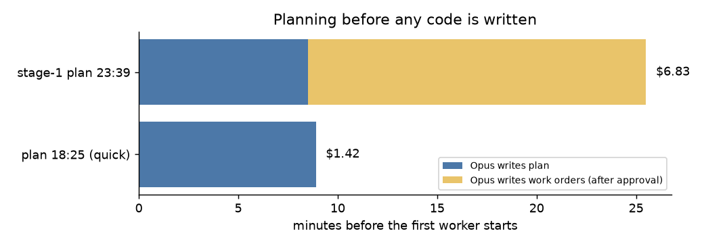

# Speed report: why a harness run is slower than one Claude session

Date 2026-10-27. Data: `events.jsonl` of runs `20261026-190201` and `20261027-000801` (clean
re-run of Stage 1, 10 orders), `.harness/planner/events.jsonl`, and two timings made today on
this repo. No code was changed. This report stops before any plan: see "Decision needed".

## 1. Where the time goes (measured)

| Finding | Number |
|---|---|
| Healthy attempt: worker (model) | 4.3–8.5 min |
| Healthy attempt: verify | 3.5–4.4 min, every attempt |
| Full suite `uv run pytest -q`, serial | 300 s for 1183 tests, 23% CPU (idle/IO bound) |
| Same suite, `pytest -n 8` (pytest-xdist) | **58 s**, 1183 pass |
| Targeted tests for one order | 6 s |
| `ruff check` + `ruff format --check` | 0.1 s |
| One flaky-test escalation (run 190201) | 48 min verify + a second worker + a second verify |
| Dead or stalled workers (run 000801) | 279–504 min per task, 15 h "active" run |
| Planning before any worker starts | 8–9 min plan, then 3–17 min and $1.3–4.2 more for work orders |

Every order's acceptance list is the targeted test, then the **full suite**, then ruff.
The worker prompt (rule 4) tells the model to run all of it, and the verifier then runs the
same commands again. So the full suite runs at least twice per attempt, and the verify step
(about 4 min) is as long as the model's work. Workers are cheap and fast; the pipeline around
them is not.

## 2. Ceiling per fix

Simulation of Stage 1 (10 orders, 4 slots, all first-try passes, measured times; `chat-images`
and the stalled `orch-images` use the median of the others). Assumption: a worker's session
contains one full-suite run (about 3.4 min), removed when workers run targeted tests only.

| Change | Stage 1 wall | Saved |
|---|---|---|
| Today (waves, full suite in worker and verifier) | 58 min | |
| Schedule by dependency instead of waves | 57 min | ~1 min (graph is narrow here) |
| xdist for the full suite, workers run targeted tests only | 27 min | 31 min |
| Verifier runs targeted tests per order, full suite once at the end | 23 min | 4 more |

The big win is verification (a 2.5x cut), not scheduling. Dependency scheduling matters only
for wide plans; this Stage 1 was almost a chain.

The tail dominates over the typical case. Stalled workers (up to 8 h per task), a flaky test
(48 min) and a dirty main checkout (3 passing tasks lost, 5 blocked) cost more than all the
steady-state overhead combined. These are not in the 58 → 23 figures, because the simulation
assumes no failures.

| Fix | Affects | Evidence |
|---|---|---|
| Stall timeout + dirty-tree check before start | runs that die or merge-fail | 000801: 15 h, 8 orders affected |
| Retry a failing test, then check it on the base commit before escalating | any attempt that hits a flake | 190201: ~55 min, $0.37 |

## 3. Planning and the single-pass flow

Today: Opus writes the plan (8–9 min), you approve, then Opus runs again to write the work
orders (3–17 min, up to +$4.2, including long pasted `context` blocks), then `harness run`
starts cold workers. The hand-off after approval is the extra phase you do not want.

Single pass: prompt → Opus asks questions → Opus writes the plan **and the ordered
implementation steps** in one session → you approve → implementation starts in that same
session or from that plan's steps, with no work-order generation.

Ceiling (rough, not measured): removes the 3–17 min / $1.3–4.2 work-order phase and every
cold worker start. If Opus implements the steps itself, serial time for Stage 1 is about the
sum of the workers' times without the full-suite run, about 39 min with no parallelism, so it
only beats the 23 min harness figure if independent steps run in parallel. The log item
"compare through `claude -p`" has not been run, so the single-session baseline is unmeasured.

Two designs:

- **A. Opus implements in-session; parallel Sonnet/Haiku subagents for independent steps.**
  Keeps context, no cold starts, no work orders. Risk: Opus-priced tokens for edits;
  the harness's file-ownership, verification and escalation guards would need reimplementing
  or dropping.
- **B. Same call writes plan + work orders, harness runs them unchanged.** Smallest change and
  keeps all guards. Saves only the second Opus pass; workers still cold-start.

## 4. Regression risk

| Fix | Risk |
|---|---|
| Targeted tests per order, full suite once at the end | A cross-order regression is found at the end, not at the order that caused it; needs a bisect-style fallback. |
| xdist | Tests that share ports, files or the repo checkout can fail in parallel (`test_ui_shutdown` already fails when started from a backgrounded shell). Needs a clean `-n 8` check; it passed today. |
| Flake retry on base commit | Costs one extra run per failure; can mask a real intermittent bug. |
| Single pass, Opus in-session | Loses isolated worktrees, `files_owned` enforcement and independent verification unless rebuilt. |

## 5. Verdict

Potential is high for the verification fixes (about 2.5x on Stage 1, plus avoiding multi-hour
tails) and uncertain for the single-pass flow (removes a 3–17 min phase but the implementation
speed vs a plain Claude session is unmeasured).

## Decision needed

1. Proceed with the verification/stability fixes (xdist, targeted-first, flake retry, stall
   timeout, dirty-tree check)? Recommended: yes.
2. Single-pass flow: design A, B, or measure first (3 runs of `claude -p` vs the harness)?
   Recommended: B now, measure A later.

After your decision I will draft a very high-level plan, save it to a file, and remind you to
update the log, start a new conversation, and plan with a big model.

## Decision update (2026-10-27)

The full suite is not part of any order. Workers and the verifier run only the order's
targeted tests and ruff; the full suite runs only when the user asks, through a "Run tests"
button in the UI (xdist, about 58 s). This replaces "full suite once at the end": the Stage 1
ceiling is about 22 min instead of 23. Cost: a cross-order regression is found when the
button is pressed, not at the order that caused it. Still open: plan flow (design A or B).
