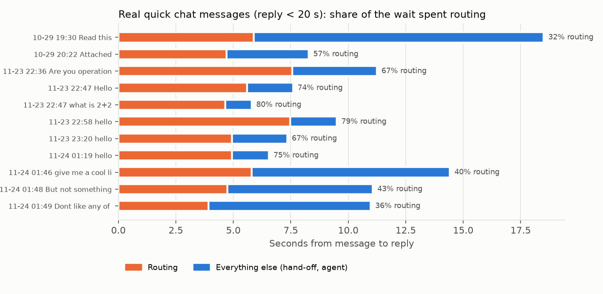
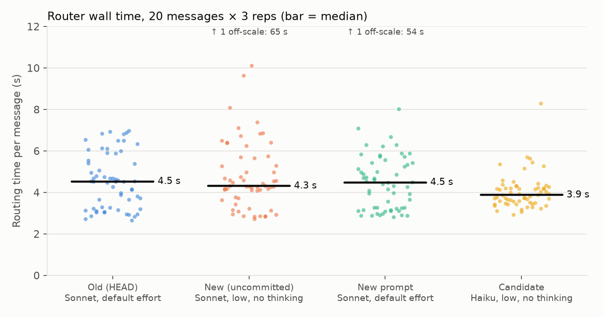
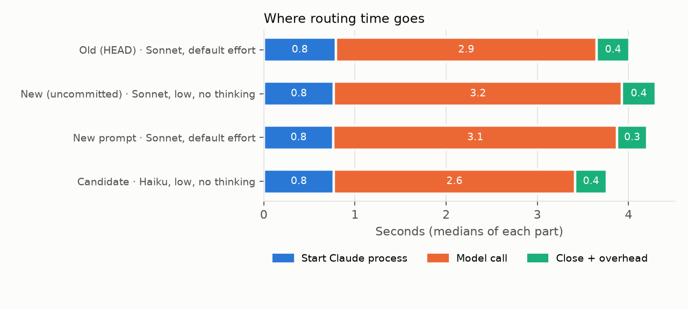
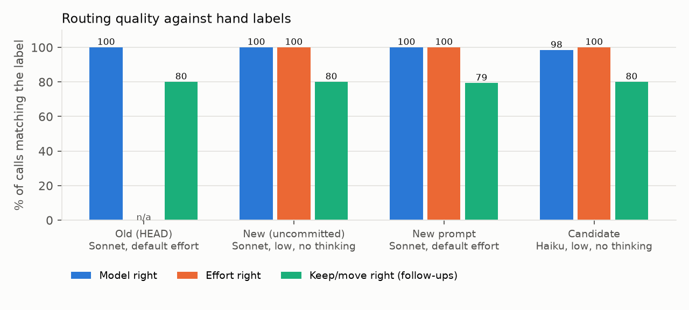
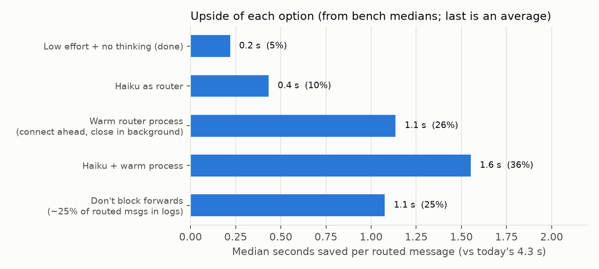

# Router latency: is it worth optimising, and how?

Date: 2026-11-24. Data: the real event log (`.harness/planner/events.jsonl`, 36 Orchestrator
exchanges) and a controlled bench of 240 real routing calls (20 hand-labelled messages × 4
router configs × 3 reps). Bench cost $0.75. Scripts and raw data are in `bench/`.

## TL;DR

- **The effort change did not make routing faster.** HEAD median 4.5 s, the uncommitted
  low-effort/no-thinking router 4.3 s. The difference is −0.2 s, with a 95% CI of −0.4 to
  +0.5 s, so it's noise. Its value is routing *quality*: the router now picks an effort, and
  it gets it right 100% of the time on the labels.
- **The earlier "7–10 s per message" claim was based on 3 slow messages.** The real median
  is 4.9 s before the change (n=11) and 4.5 s after (n=9).
- **Routing is still most of the wait on quick messages.** On 11 real chat messages that
  were answered in under 20 s, routing was 67% of the wait (median).
- **Where the 4.3 s goes:** about 0.8 s starting the Claude process, 3.2 s for the model call
  and 0.4 s closing. Only the model call depends on the model.
- **Best upside for the risk: a warm router process** (connect ahead of time, close in the
  background). It saves about 1.1 s (26%) on every routed message without changing any
  routing decision. Adding **Haiku as the router** brings the total to about 1.6 s (36%) and
  cuts routing cost by 90%, at a small quality risk.
- **"Don't block forwards" (my earlier suggestion) is the weakest option.** It averages
  about 1.1 s, but only applies to the ~25% of routed messages that are plain forwards, and
  it is the most complex. Drop it.

## 1. How many messages does this affect?

| | Count |
|---|---|
| Orchestrator exchanges in the log | 36 |
| Already skip the router (Opus holds the thread, or a resumed agent) | 16 |
| **Go through the router** | **20** |
| …new requests (no holder, so routing can't be skipped) | 12 |
| …follow-ups | 8 (5 forward, 2 switch down, 1 escalate) |

Every routed message pays the router cost, so optimising the router itself helps all 20.
Skipping the router for follow-ups would only help the 5 forwards.

## 2. Current performance

On quick chat messages, the router is 32–80% of the time from message to reply
(median 67%). On long tasks (planning, implementation) it doesn't matter: 4 s out of minutes.

| Arm | Median | p90 | Bootstrap 95% CI vs HEAD | Cost / call |
|---|---|---|---|---|
| Old (HEAD): Sonnet, default effort | 4.5 s | 6.5 s | — | $0.0043 |
| New (uncommitted): Sonnet, low, no thinking | 4.3 s | 6.9 s | −0.4 to +0.5 s | $0.0042 |
| New prompt, Sonnet, default effort | 4.5 s | 6.2 s | −0.6 to +0.6 s | $0.0037 |
| **Haiku, low, no thinking** | **3.9 s** | **5.2 s** | **−0.9 to −0.04 s** (−0.9 to −0.2 vs new) | **$0.0004** |

Two calls took 54 s and 65 s: one stalled on connect, one on the API. These are rare, but
there is no timeout on the router today.

The router replies with about 250 output tokens either way, so effort and thinking had
little to cut. Sonnet was barely thinking on this prompt to begin with. The connect time
(0.8 s) and close time (0.4 s) are the same in every arm.

## 3. Regression risk (quality)

- **Model pick:** 100% for all three Sonnet arms. Haiku got 98%, with 1 miss in 60: for the
  staged git-UI project it answered `"to": "sonnet", "plan": "project"`, which is internally
  inconsistent. A one-line rule ("plan=project ⇒ opus") would catch it.
- **Effort pick:** 100% for every arm that outputs effort. HEAD outputs none, so every chat
  gets medium.
- **Keep or move on follow-ups:** 80% for every arm. The 20% "misses" are the new prompt
  switching a Sonnet chat down to a *new* Haiku agent for "great, thanks!" and "make the
  default 50 instead". That's allowed by the prompt, but the user pays a fresh agent startup
  and the agent loses its own context. This is a side effect of the switch-down change,
  not of the effort change.
- **Parse failures:** 2 of 240 calls (0.8%) returned `"plan": null`, which fails
  `Routing` validation, so the Orchestrator falls back to defaults. Accepting `null` would
  fix it.

## 4. Ceiling per option

| Option | Saves per routed msg | Affects | Risk | Size |
|---|---|---|---|---|
| Low effort + no thinking (done) | ~0.2 s, within noise | all | none | done |
| Haiku as router | 0.4 s (10%) | all | 1/60 tier miss; −90% cost | tiny |
| Warm router process | ~1.1 s (26%) | all | none to routing quality; one idle Claude process | small–medium |
| **Haiku + warm process** | **~1.6 s (36%)** | all | as Haiku | small–medium |
| Don't block forwards | 4.3 s on forwards, ~1.1 s averaged | ~25% | wrong-agent work to cancel when the router disagrees | large |

"Warm process" is a projection: it assumes removing the measured connect and close medians
from the critical path. It hasn't been built or measured. On the 11 real quick messages
(median 9.5 s from message to reply) it would take the wait to about 8.4 s, or about 7.9 s
with Haiku.

## Recommendation

If you want to go ahead: (1) a warm router process, and (2) Haiku as the router with the
`plan=project ⇒ opus` guard. Bundle the two small robustness fixes (accept `"plan": null`,
add a router timeout). Separately, decide whether a "thanks" or tiny tweak should really
switch a Sonnet chat to a new Haiku agent.
